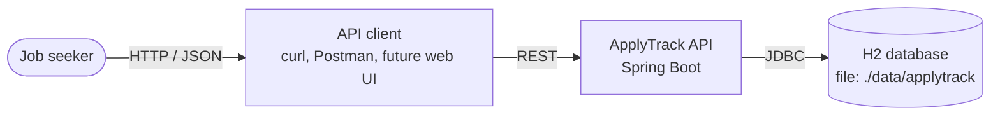
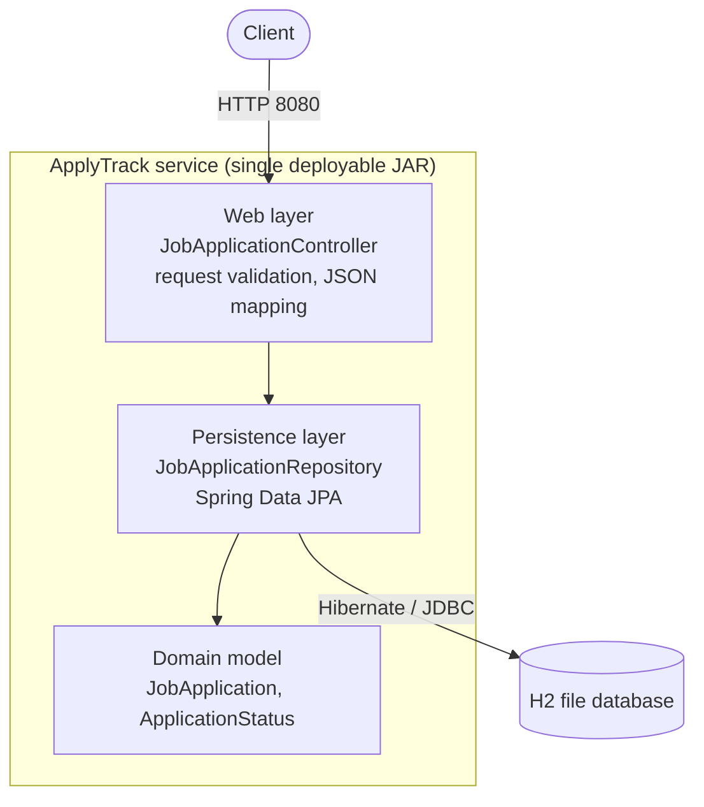
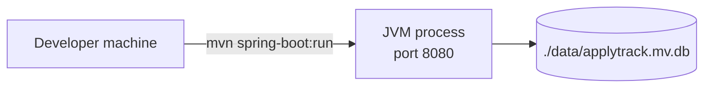
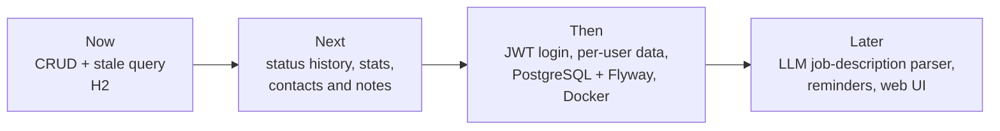
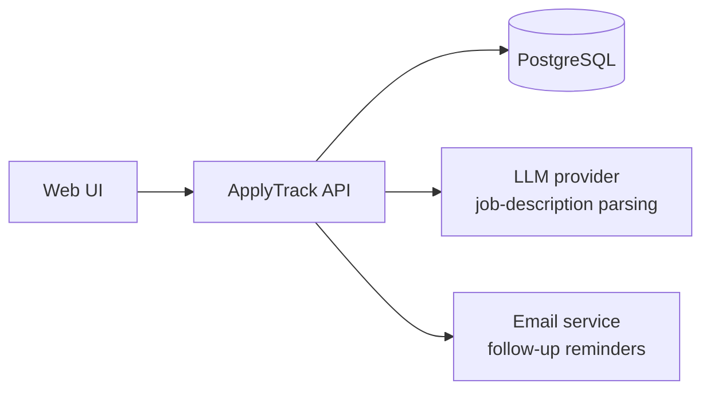

# High-Level Design (HLD)

## 1. Overview

ApplyTrack is a single-service REST API that lets a job seeker record job applications, track their stage, and find applications that have gone quiet. It is a Spring Boot monolith backed by an embedded file-based H2 database, so it runs with no external setup.

## 2. System context

## 3. Component view

## 4. Technology choices

| Concern | Choice | Reason |
| --- | --- | --- |
| Language / runtime | Java 21 | Current LTS, records for DTOs |
| Framework | Spring Boot 3.5 | Mature, fast to build REST APIs |
| Persistence | Spring Data JPA + Hibernate | Minimal boilerplate for CRUD and derived queries |
| Database | H2 (file mode) | Zero setup, data survives restarts |
| Validation | Jakarta Bean Validation | Declarative request checks |
| Build | Maven | Standard for Spring Boot |
| Tests | JUnit 5, MockMvc, `@SpringBootTest` | End-to-end through the web layer on in-memory H2 |

## 5. API surface

| Method | Path | Purpose |
| --- | --- | --- |
| POST | `/api/applications` | Create an application |
| GET | `/api/applications` | List all, optional `?status=` filter |
| GET | `/api/applications/{id}` | Fetch one |
| PUT | `/api/applications/{id}` | Replace an application's fields |
| DELETE | `/api/applications/{id}` | Delete |
| GET | `/api/applications/stale?days=N` | `APPLIED` applications older than N days (default 14) |

## 6. Data

One table, `job_application`. See the entity-relationship diagram in the [LLD](lld.md#4-data-model).

## 7. Deployment (current)

The `data/` directory is git-ignored.

## 8. Non-functional notes

- **Scalability:** single instance with an embedded database. Adequate for personal use. Scaling out needs an external database.
- **Security:** none yet. The API is unauthenticated and has no per-user data separation.
- **Reliability:** state lives in one local file. There are no backups.
- **Observability:** Spring Boot's default logging only.

## 9. Planned evolution

Planned target architecture (not yet built):

