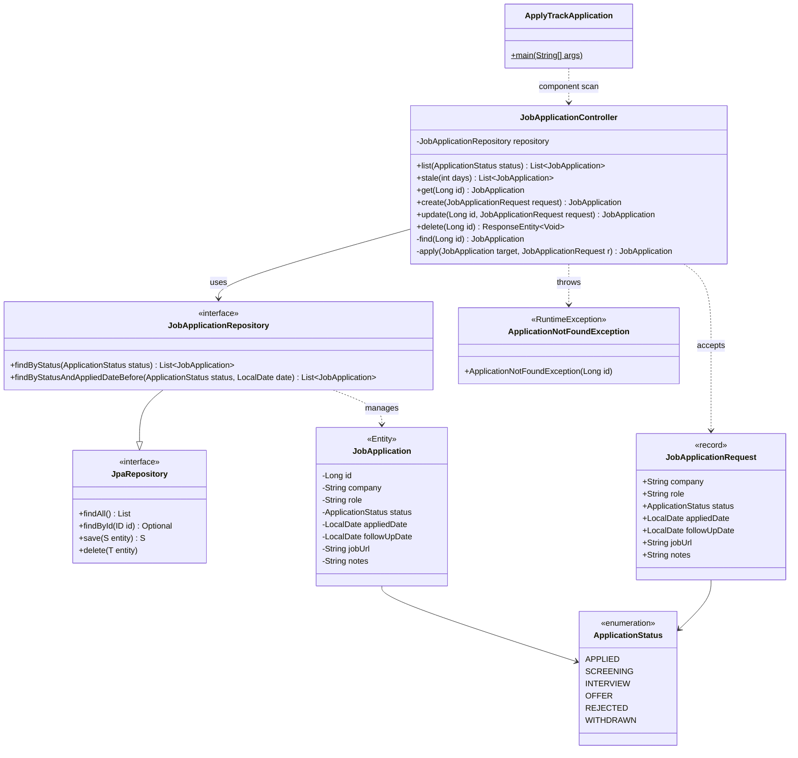
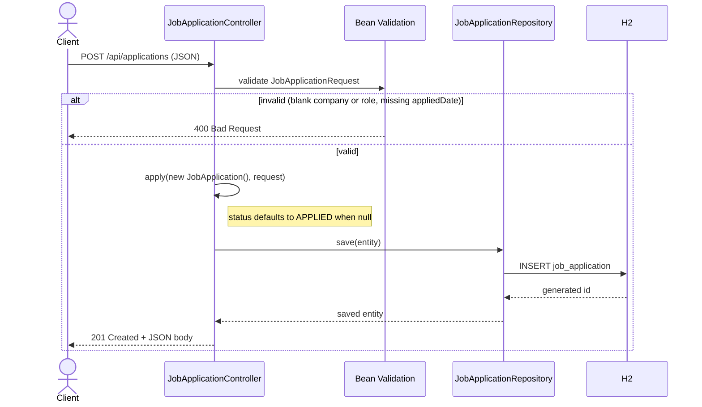
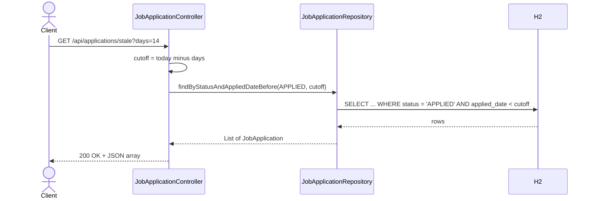
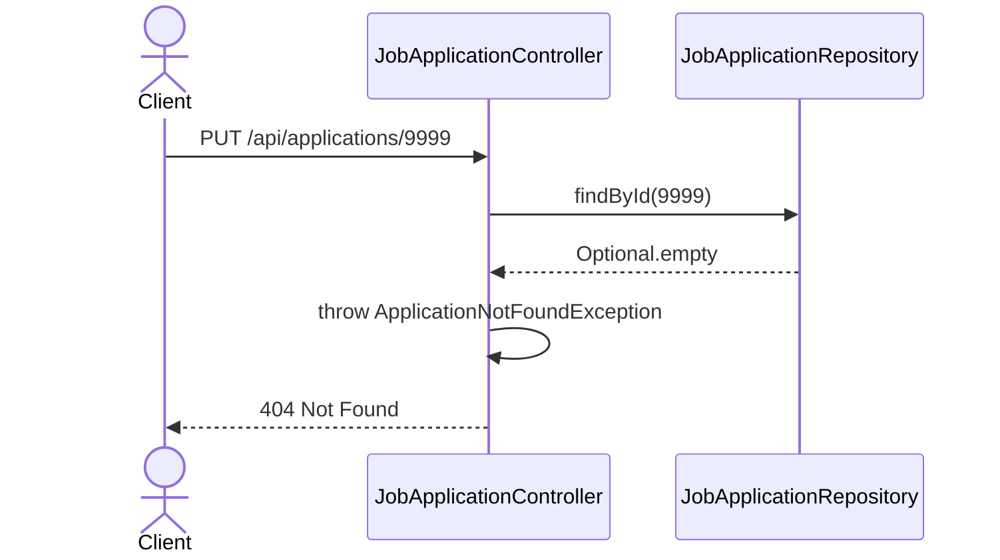
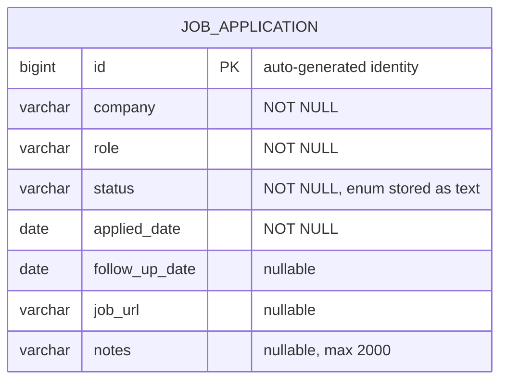

# Low-Level Design (LLD)

Describes the code as it exists today, in package `com.applytrack`.

## 1. Package layout

```
com.applytrack
├── ApplyTrackApplication            Spring Boot entry point
└── application
    ├── JobApplication               JPA entity
    ├── ApplicationStatus            enum
    ├── JobApplicationRequest        request record (validated)
    ├── JobApplicationRepository     Spring Data JPA repository
    ├── JobApplicationController     REST controller
    └── ApplicationNotFoundException maps to HTTP 404
```

## 2. Class diagram



The controller talks to the repository directly. There is no service layer yet, which is acceptable while the logic is plain CRUD. A service layer becomes worthwhile once status-transition rules, history, or reminders are added.

## 3. Sequence diagrams

### 3.1 Create an application



### 3.2 Get stale applications



### 3.3 Update or delete (not found path)



## 4. Data model



The schema is created and updated by Hibernate (`spring.jpa.hibernate.ddl-auto=update`). Moving to Flyway migrations is planned together with PostgreSQL.

## 5. Request validation rules

| Field | Rule |
| --- | --- |
| `company` | required, not blank |
| `role` | required, not blank |
| `appliedDate` | required, ISO date (`yyyy-MM-dd`) |
| `status` | optional, defaults to `APPLIED` |
| `followUpDate`, `jobUrl`, `notes` | optional |

## 6. Error handling

| Situation | HTTP status | Mechanism |
| --- | --- | --- |
| Validation failure | 400 | `MethodArgumentNotValidException`, Spring default |
| Unknown status value or malformed JSON | 400 | Spring default |
| Application id not found | 404 | `ApplicationNotFoundException` with `@ResponseStatus` |

Error bodies use Spring Boot's default format. A custom error response is a possible later improvement.

## 7. Known limitations

- Status transitions are not validated: any status can be set from any other.
- `PUT` replaces all fields, so a client must send the full object.
- No pagination on list endpoints.
- No authentication, and no per-user data separation.
- `GET /stale` only considers `appliedDate`, not `followUpDate`.
