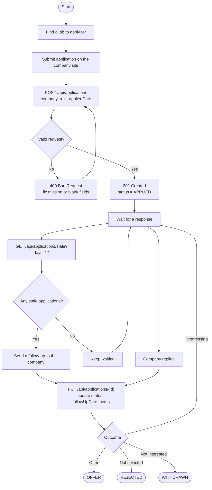
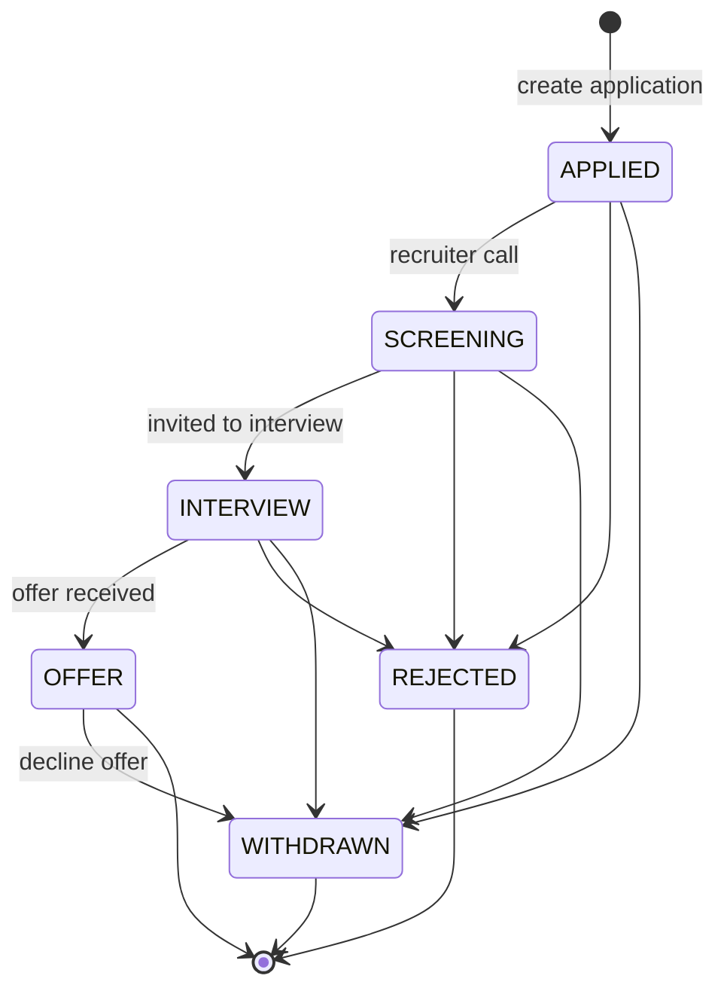
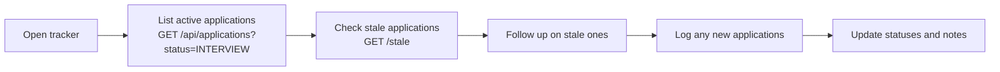

# User Flow

How a job seeker uses ApplyTrack, from logging an application to following up on it.

## 1. End-to-end flow

## 2. Application status lifecycle

The statuses a typical application moves through. The API does not currently enforce these transitions: any status can be set directly with an update.

## 3. Daily routine

